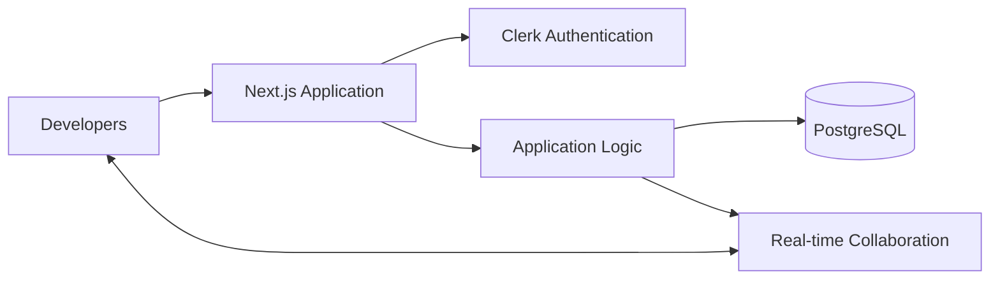
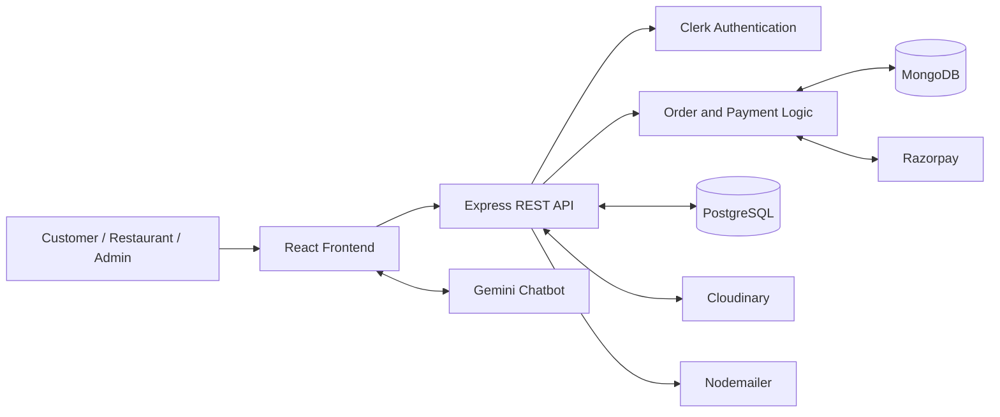
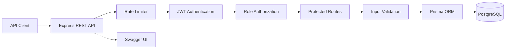

# Arjun Gupta

**I build full-stack applications with a focus on backend engineering, security, and systems that work beyond the happy path.**

MCA Scholar · **C-DAC Noida (GGSIPU)** · Class of 2027

[Portfolio](https://arjun-gupta-developer.vercel.app/) &nbsp;·&nbsp;
[LinkedIn](https://linkedin.com/in/arjun-gupta-948b11291) &nbsp;·&nbsp;
[LeetCode](https://www.leetcode.com/arjung7751) &nbsp;·&nbsp;
[HackerRank](https://www.hackerrank.com/arjung7751) &nbsp;·&nbsp;
[Email](mailto:arjung.dev29@gmail.com)

```console
$ whoami
Arjun Gupta — Software Engineer in progress

$ focus
Full-stack engineering · Backend systems · DSA · DevOps
```

I care about the parts of software engineering that are easy to overlook: authorization boundaries, data consistency, validation, failure handling, and deployment. My projects are where I work through those problems, from designing REST APIs to connecting authentication, databases, and third-party services.

---

## What I'm building

### [Code Canvas](https://code-canva-six.vercel.app/) &nbsp;·&nbsp; <sub>Collaborative development platform</sub>

A collaborative coding workspace designed to bring code editing and developer communication together. The project explores the engineering behind a shared development environment, including authentication, database-backed application state, and real-time collaboration.

**The engineering focus:** managing shared state, designing the data model, organizing application features, and understanding how real-time communication fits into a full-stack system.

**Stack:** Next.js · TypeScript · Tailwind CSS · PostgreSQL · Prisma · Clerk



### [TasteBudsTreat](https://taste-buds-treat.vercel.app/) &nbsp;·&nbsp; <sub>MERN food ordering platform</sub>

A food ordering application built as a college team project. It supports customer ordering workflows, restaurant management, menu browsing, and administrative functionality.

The project brings together several backend concerns that are useful beyond a basic CRUD application:

- **Authentication and role-based access:** Clerk-powered authentication and role-specific customer, restaurant, and admin experiences.
- **Order and payment workflows:** Razorpay integration, with webhook handling designed around order references and duplicate-event protection.
- **Cart management:** Redux-based state management with local storage persistence.
- **Menu discovery:** Filtering by cuisine and vegetarian/non-vegetarian options, alongside pagination.
- **Media and notifications:** Cloudinary image handling and email notifications through Nodemailer.
- **Conversational interface:** Gemini-powered food-ordering chatbot.

**Stack:** React · Node.js · Express.js · MongoDB · PostgreSQL · Clerk · Razorpay · Redux · Cloudinary · Nodemailer · Gemini



### FinTrack API &nbsp;·&nbsp; <sub>Finance management backend</sub>

A REST API focused on financial records, access control, and predictable request handling. This project is where I work on backend fundamentals that matter when different users need different levels of access to sensitive application data.

**What it covers:**

- **JWT authentication:** token-based authentication with password hashing using bcrypt.
- **Role-based access control:** separate `VIEWER`, `ANALYST`, and `ADMIN` permissions.
- **Input validation:** Zod schemas for validating incoming data.
- **Rate limiting:** fixed-window request limiting to reduce excessive traffic.
- **Database access:** Prisma ORM with PostgreSQL.
- **API documentation:** Swagger UI through `/api-docs`.
- **Deployment:** Docker-based containerization and deployment troubleshooting.

I chose PostgreSQL for its relational data model and transaction guarantees, which suit financial records and structured relationships.

**Stack:** Node.js · Express.js · PostgreSQL · Prisma · JWT · bcrypt · Zod · Docker · Swagger · Postman



---

## Engineering decisions, explained

A technology list tells you what someone has used. The more useful question is how they apply it.

These are the implementation decisions I focus on across my projects:

| Engineering concern | How I approach it |
|---|---|
| Authentication | Separate identity verification from application authorization. |
| Authorization | Enforce role permissions on protected backend operations, not just in the UI. |
| API validation | Validate incoming data before it reaches business logic or database operations. |
| Payment processing | Account for webhook retries and duplicate events when updating order state. |
| Data modeling | Choose relational or document-based storage based on the data and access patterns. |
| Error handling | Return meaningful HTTP status codes and consistent API responses. |
| Rate limiting | Put request limits in the request pipeline to reduce abuse. |
| Deployment | Use Docker and deployment tooling to make application environments more reproducible. |

These are engineering principles reflected in my project work, not a claim that every project implements every item identically.

---

## How I approach engineering

- **Security belongs on the backend.** Hiding a button is not authorization. Protected operations need server-side checks.
- **Validate at the boundary.** Invalid requests should be rejected before they cause inconsistent state.
- **Think about retries.** Payment callbacks and other external events can be delivered more than once.
- **Choose the right data model.** Relational integrity and flexible document structures solve different problems.
- **Make APIs understandable.** Clear resource boundaries, consistent responses, and API documentation improve maintainability.
- **Test failure cases.** Negative values, missing fields, unauthorized requests, duplicate events, and invalid state transitions deserve attention.
- **Learn by shipping.** Building, deploying, debugging, and revisiting implementation decisions is part of becoming a better engineer.

---

## Stack

<details>
<summary><b>Languages and frontend</b></summary>

<br>

| Area | Technologies |
|---|---|
| Languages | Java · JavaScript · TypeScript · C++ · Python · SQL |
| Frontend | React · Next.js · Redux · HTML5 · CSS3 |
| Styling and UI | Tailwind CSS · Material UI · Bootstrap |
| Routing and forms | React Router · React Hook Form |

</details>

<details>
<summary><b>Backend and databases</b></summary>

<br>

| Area | Technologies |
|---|---|
| Backend | Node.js · Express.js · REST APIs |
| Databases | PostgreSQL · MongoDB · MySQL |
| ORM and data access | Prisma |
| Authentication | JWT · Clerk · bcrypt |
| Validation and security | Zod · RBAC · Rate limiting |
| Integrations | Razorpay · Cloudinary · Nodemailer · Gemini |
| API testing and documentation | Postman · Swagger |

</details>

<details>
<summary><b>DevOps and development tools</b></summary>

<br>

| Area | Technologies |
|---|---|
| Containers | Docker |
| CI/CD | GitHub Actions · Jenkins |
| Cloud and deployment | AWS · Vercel · Netlify |
| Infrastructure and networking | Nginx · Kubernetes |
| Development environment | Linux · Bash · Git · GitHub |
| Other tools | npm · Windows Terminal |

</details>

---

## Beyond projects

### Data structures and algorithms

I practise DSA consistently to improve problem-solving, algorithmic thinking, and implementation skills.

- [LeetCode](https://www.leetcode.com/arjung7751)
- [HackerRank](https://www.hackerrank.com/arjung7751)

My focus is on understanding the reasoning behind a solution, including time complexity, space complexity, edge cases, and alternative approaches.

### Currently learning

- **DevOps:** Linux fundamentals, Docker, CI/CD, and deployment workflows.
- **DSA:** Problem-solving patterns, data structures, and algorithm analysis.
- **Backend engineering:** API design, authentication, authorization, data modeling, and reliability.

---

## Other work

Explore more projects, experiments, and development work through my [portfolio](https://arjun-gupta-developer.vercel.app/) and [GitHub profile](https://github.com/arjung352).

I also publish articles on [DotBlog](https://blogingdotblog.netlify.app/).

---

<div align="center">

**Open to software engineering, backend development, and full-stack opportunities.**

[Portfolio](https://arjun-gupta-developer.vercel.app/) &nbsp;·&nbsp;
[LinkedIn](https://linkedin.com/in/arjun-gupta-948b11291) &nbsp;·&nbsp;
[Email me](mailto:arjung.dev29@gmail.com)

</div>
